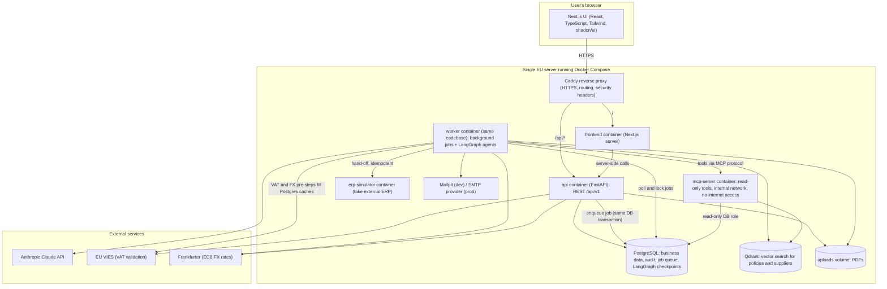
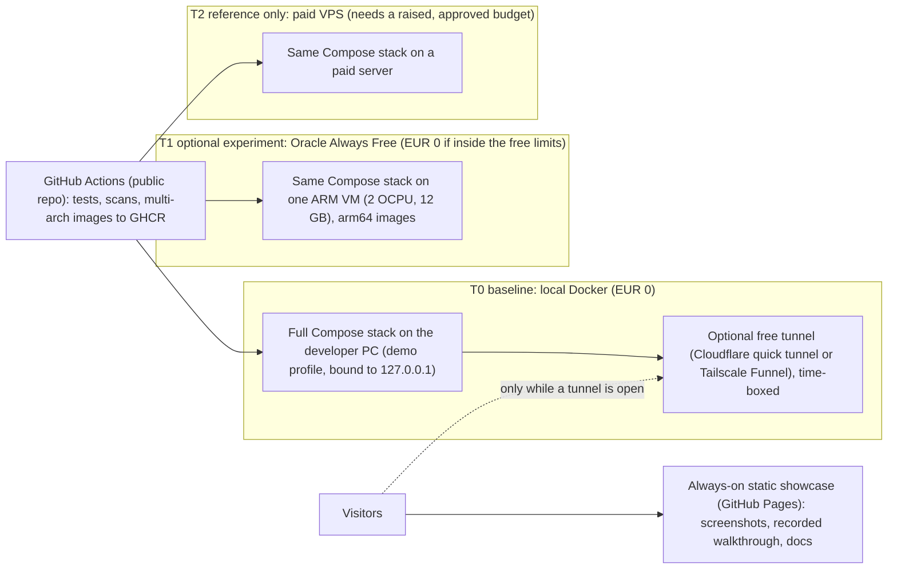
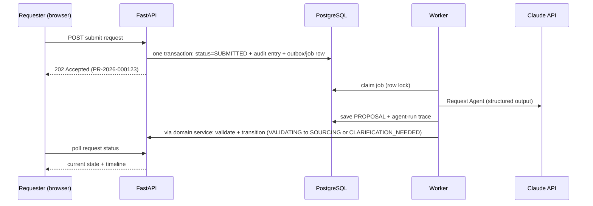

# ProcureFlow AI: System Architecture

| | |
|---|---|
| **Document status** | **Revision 3**: draft for review with technical mentor. Revision 2 addressed the independent architecture review. Revision 3 re-baselines deployment and cost on the approved EUR 5 per month budget (see Section 19) |
| **Date** | 2026-11-07 |
| **Scope** | System architecture planning only. No implementation has started |
| **Companion document** | [`ai-native-operating-model.md`](./ai-native-operating-model.md) |
| **Decision status convention** | Every decision is **Proposed — pending approval** unless the project owner has explicitly approved it. Only the baseline decisions in Section 0 (the 12 original ones and B-1 to B-6) are approved |

---

## 0. Baseline decisions (explicitly approved by the project owner)

These 12 decisions were approved by the project owner after the requirements review. They are fixed constraints for this architecture. **Decision 5 (EUR 20–30 per month) was superseded on 2026-11-07 by decision B-4 below.**

| # | Decision | Status |
|---|---|---|
| 1 | Portfolio and learning project using synthetic procurement data, designed with production-grade security principles | **Approved** |
| 2 | MVP covers physical goods only | **Approved** |
| 3 | Synthetic supplier database, manual quotations and PDF uploads | **Approved** |
| 4 | Two external APIs: EU VIES for VAT validation and Frankfurter for currency exchange rates | **Approved** |
| 5 | ~~Target recurring cost EUR 20–30 per month, with cost controls and an explicit warning if the target is unrealistic~~ **Superseded by B-4** (strict EUR 5 per calendar month) | **Superseded** |
| 6 | Configurable demo approval thresholds at EUR 2,000, EUR 25,000 and EUR 100,000 | **Approved** |
| 7 | Three-quotation requirement above EUR 5,000, with documented exceptions | **Approved** |
| 8 | Human authorization is mandatory for financial commitments | **Approved** |
| 9 | Modular monolith with a separate background worker | **Approved** |
| 10 | FastAPI, Next.js, PostgreSQL, Qdrant, LangGraph, Docker Compose and MCP | **Approved** |
| 11 | Local open-source embeddings model | **Approved** |
| 12 | Single-organization MVP, with possible multi-tenancy later | **Approved** |

### Budget and deployment decisions approved on 2026-11-07 (Revision 3)

| # | Decision | Status |
|---|---|---|
| **B-1** | **T0 is the baseline.** The full stack runs locally in Docker, with optional temporary public access through a free tunnel. **Oracle Cloud Free Tier (T1) is an optional experiment, not a dependency** | **Approved** |
| **B-2** | **Public GitHub repository, synthetic data only.** No secrets, credentials or private information may be committed | **Approved** |
| **B-3** | **No paid domain.** Free URLs and tunnels only | **Approved** |
| **B-4** | **Strict maximum of EUR 5 per calendar month** for all additional purchases and services combined. The existing Claude and Cursor subscriptions are excluded. **Nothing is purchased and no paid service is enabled without the project owner's explicit approval** | **Approved** |
| **B-5** | **T3 demo target (approved 2026-11-08).** Vercel Hobby (frontend and backend as two separate projects) plus Neon Free (PostgreSQL). No card, no paid plan, no domain. Demo only, synthetic data only. A database must exist before any production write is enabled (task 0002). T0 stays the baseline | **Approved** |
| **B-6** | **No unrestricted public access (approved 2026-11-08).** Until authentication (S1) exists and the findings B1 to B5 of task 0001 are fixed, every public URL must be owner-only (Vercel Authentication, scope "All Deployments"), and the backend must answer requests without the gateway token with the contract's 404 problem | **Approved** |

All AD decisions in Section 15 stay **Proposed — pending approval**, including AD-9 and AD-15, even though they implement B-1 to B-4.

**Three principles run through the whole design**
1. **PostgreSQL is the single source of truth.** Everything else (Qdrant, LangGraph checkpoints, caches) can be rebuilt or thrown away.
2. **Deterministic code owns state and money. LLMs only prepare proposals.**
3. **Prefer fewer moving parts.** Every extra container is something a beginner must understand, secure, and pay for.

---

## 1. High-level architecture



### Deployment targets (Revision 3)
The diagram above shows the **production topology**. Under the approved budget (B-1 to B-4), that same topology runs in three possible places. **T0 is the baseline**, T1 is an optional experiment, and T2 is only a reference that would require a raised, explicitly approved budget. Details and costs are in Section 13.



### Sequence of one agent step



### Why each component exists

| Component | What it is | Why necessary |
|---|---|---|
| **Browser UI (Next.js)** | The screens users see | Required frontend. Next.js also renders pages on the server for fast, secure first loads |
| **Caddy reverse proxy** | A "front door" that receives all internet traffic | Gives automatic HTTPS and puts the UI and API on one web address. Same address means no cross-site cookie or CORS problems, which are the most common beginner security bugs |
| **FastAPI (api)** | The backend that answers HTTP requests quickly | Enforces login, permissions and business rules. It never waits for an LLM |
| **Worker** | A second process running the same backend code | LLM calls take 10–60 s. Doing them inside a web request would time out and block users. The worker does slow jobs in the background |
| **MCP server** | A small server offering read-only "tools" to agents | The required MCP piece. It is the controlled window through which agents look things up |
| **PostgreSQL** | The main relational database | Stores everything that must be correct and auditable |
| **Qdrant** | A vector database | Finds text by meaning ("ergonomic seating" matches "office chairs"). Used for policy RAG and supplier search |
| **ERP simulator** | A tiny fake ERP API | Stands in for the external system, since there is no commercial ERP |
| **Mailpit / SMTP** | Catches or sends email | Lets RFQ emails be tested without emailing anyone |

---

## 2. Backend modules (modular monolith)

A **modular monolith** is one deployable application whose code is split into clearly separated modules. It gives clean boundaries without the pain of microservices (networking, distributed failures, many deployments).

| Module | Responsibility |
|---|---|
| `identity_access` | Users, password hashing, sessions, roles, permission checks |
| `requests` | Procurement requests, the **lifecycle state machine**, clarifications |
| `suppliers` | Supplier master data, VAT validation results, status |
| `rfq` | RFQ drafts, review, dispatch records |
| `quotes` | Quotation capture and verification, currency conversion |
| `evaluation` | **Deterministic scoring engine** (weights, ranking) |
| `compliance` | Hard-rule engine (deterministic), findings, exceptions, policy documents |
| `approvals` | Approval chain calculation, decisions, snapshot hashing |
| `purchase_orders` | PO drafts, release, hand-off orchestration, ERP adapter |
| `documents` | Upload validation, storage, PDF text extraction |
| `agents` | The 6 agents: prompts, output schemas, tool allowlists, run recorder, guardrails |
| `integrations` | Clients for VIES, Frankfurter, Claude, email, ERP (ports and adapters) |
| `audit` | Append-only audit writer and reader |
| `notifications` | In-app and email notifications |
| `jobs` | Queue, worker loop, retries, scheduled jobs |
| `admin_config` | Thresholds, weights, budgets, caps |
| `platform` | Settings, logging, DB sessions, error format |

**Layering rule (very important):** `API routes → application services → domain logic → repositories (DB)`.
- The **agents module only calls application services, never repositories or tables.**
- Modules talk to each other only through each module's public service interface, never by reaching into each other's tables.
- This can be enforced automatically later with an import-linter test in CI.

**Transactional outbox:** when a state changes, the API writes the new state, the audit entry, and a "job to do next" row in the same database transaction. Either all three happen or none do, so a crash cannot leave a request stuck with no follow-up job. This is the core reliability pattern of the whole design.

---

## 3. Frontend architecture and routing

**Stack:** Next.js (App Router), TypeScript, Tailwind, shadcn/ui, TanStack Query (client-side data fetching and polling), React Hook Form with Zod (forms and validation), `openapi-typescript` (generates TypeScript types from FastAPI's OpenAPI spec, so frontend and backend cannot silently drift apart).

**Principle:** the frontend is a thin client. It displays state and sends commands. It contains no business rules. Hiding a button is cosmetic, because the server enforces everything.

```
app/
  (auth)/login
  (app)/                          <- protected layout with role-aware sidebar
    dashboard                     <- role-specific home
    requests/                     <- My requests (list)
    requests/new
    requests/[id]/                <- tabs: overview | suppliers | rfq | quotes |
                                     evaluation | compliance | approval | po |
                                     timeline | agent-trace
    buyer/queue                   <- Buyer work queue
    approvals/ and approvals/[id] <- Approval inbox and decision page
    suppliers/ and suppliers/[id]
    compliance/exceptions
    policies/                     <- Policy library (upload, versions)
    audit/                        <- Auditor explorer and export
    notifications
    admin/users | admin/config | admin/agent-runs
```

- **Route protection:** Next.js middleware redirects users without a session cookie to login. This is only a courtesy check. The real enforcement is in FastAPI.
- **Live progress:** polling every 3–5 s on the request page while a state is "agent working". Server-Sent Events (SSE) can replace it in Phase 2.
- **Accessibility:** shadcn/ui is built on Radix, which gives keyboard and ARIA behaviour. This helps meet WCAG 2.2 AA.

---

## 4. Frontend ↔ backend communication

- **Style:** REST with JSON under `/api/v1`, same origin via Caddy. The OpenAPI spec is generated automatically by FastAPI.
- **Commands, not blind edits.** State changes use explicit action endpoints, for example `POST /requests/{id}/actions/confirm-shortlist` or `.../release-po`, never a generic "set status = X". Each action maps to one guarded transition.
- **Async operations** return `202 Accepted` and the UI watches the request state.
- **Idempotency-Key header** on side-effecting actions (send RFQ, release PO), so a double-click or retry never doubles the effect.
- **Optimistic locking:** each record carries a `version`. If two people edit at once, the second gets a clear `409 conflict`.
- **Errors:** one consistent format (RFC 9457 "problem details"), with machine-readable codes and plain-language messages.
- **Lists:** pagination with a hard maximum page size.
- **Uploads:** `multipart/form-data` with size and type limits, processed later by the worker.

---

## 5. PostgreSQL vs Qdrant

| | PostgreSQL (source of truth) | Qdrant (derived search index) |
|---|---|---|
| **Holds** | Users, roles, sessions, requests, suppliers, RFQs, quotes, evaluations, findings, approvals, POs, audit log, job queue, agent runs, config, FX/VIES cache, LangGraph checkpoints | Vectors plus metadata for **policy chunks** and **supplier profiles** |
| **Guarantees** | Transactions, constraints, foreign keys, permissions | None of that. Similarity search only |
| **If lost** | Disaster | Rebuild from Postgres plus policy files |

- **Schemas inside one Postgres database:** `app` (business), `audit` (append-only), `jobs`, `langgraph` (checkpoints). Separate **DB roles** enforce boundaries. For example, the audit role can only `INSERT` and `SELECT`, and the MCP server's role is `SELECT`-only on a few views.
- **Qdrant collections:** `policy_chunks` (payload: document ID, version, section, effective dates, status) and `supplier_profiles` (payload: supplier ID, categories, country, status).
- **Rule:** vector search returns *IDs and passages*. Truth (is this supplier blocked?) is always re-read from Postgres, so a stale index can never approve a blocked supplier.
- **Embeddings:** a small local open-source model run on CPU through an ONNX runtime such as `fastembed` (for example a BGE-small model, 384 dimensions, to be verified at implementation). It needs a few hundred MB of RAM and no paid API. It runs in the worker, so the API stays light. A multilingual model for German comes in Phase 2.
- **Security:** Qdrant has no authentication by default. We set an API key and never publish its port to the internet.

---

## 6. Multi-agent orchestration and agent boundaries

**Key design choice: a deterministic coordinator, not an LLM "boss".** The lifecycle (domain state machine) decides which agent runs next. This is predictable, testable and safe. The system is still genuinely multi-agent: six specialised agents, each with its own prompt, tools, output schema and permissions.

**Each agent is a small, separate LangGraph graph that runs to completion in minutes.** No graph stays suspended for days waiting for a human. Human waiting happens in the *business* state, for example `SHORTLIST_REVIEW`.

| Agent | Model tier (configurable) | Tools (allowlist) | Output (strict schema) | Forbidden |
|---|---|---|---|---|
| **Request** | Cheaper | none beyond the request and attachments | Structured requirements, confidence per field, questions | Changing user-entered budget or quantity |
| **Supplier** | Cheaper | `search_suppliers`, `get_supplier` | Ranked shortlist with rationale (3–7) | Inventing suppliers; including blocked ones |
| **RFQ** | Cheaper | `get_supplier` (limited) | RFQ drafts | Sending anything; including budget or other suppliers |
| **Evaluation** | Stronger | `get_fx_rate` plus the scoring service | Narrative and flags. Scores come from code | Calculating the numbers itself |
| **Compliance** | Stronger | `search_policies`, `validate_vat`, `get_budget_status` | Findings with rule ID, severity, citation | Granting exceptions; any write tool |
| **PO** | Cheaper | none | PO text fields. Totals come from code | Releasing; calling the ERP adapter |

**Common guardrails for all agents**
- Structured output validated against a schema. If it fails, retry once, then `AGENT_FAILED`.
- Document and quote content is wrapped as *untrusted data*, with explicit instructions never to follow instructions inside it.
- Per-run token and cost caps. Every run is recorded: inputs, tool calls, retrieved passages, model, tokens, cost and result.
- **No agent identity holds permissions for approving, releasing, hand-off, audit, or user management.** This is enforced by database roles and application checks, not only by prompts.

---

## 7. LangGraph execution state vs procurement business state

This separation is the most important architecture idea for correctness.

| | **Business state** | **LangGraph execution state** |
|---|---|---|
| **Question it answers** | "Where is this purchase in its lifecycle?" | "Where is this agent run in its steps?" |
| **Examples** | `PENDING_APPROVAL`, approvals, PO totals | Intermediate messages, tool-call scratch, retry position |
| **Stored in** | `app` schema tables | `langgraph` schema checkpoints |
| **Lifetime** | Years (legal records) | Minutes to days, **disposable** |
| **Written by** | Domain services only, after guard checks | LangGraph automatically |
| **Authoritative?** | **Yes** | **No** |

**How they connect**
1. A graph node never writes business tables directly. It produces a **proposal** saved in `agent_proposals` (status `PENDING`).
2. A deterministic domain service checks the proposal, validates the actor and guards, and performs the transition.
3. The graph's `thread_id` is composed of request ID, step and attempt. If the worker crashes mid-run, LangGraph can resume from its checkpoint, or the job can safely restart because the proposal is keyed by (request, step, input hash).
4. If checkpoint data is deleted or its schema changes after a code upgrade, nothing legal is lost. At worst, one agent step re-runs.

---

## 8. Background jobs and persistence

**Recommendation: a PostgreSQL-backed job queue, with no Redis.** Candidates are a library such as Procrastinate, or a small custom `jobs` table using row locking (`FOR UPDATE SKIP LOCKED`). Reasons:
- One fewer container to run, secure, back up and learn.
- **Jobs can be enqueued in the same transaction as the state change** (the outbox pattern above). A separate Redis queue cannot guarantee that.
- Throughput needs are tiny (a handful of requests per day).

| Concern | Strategy |
|---|---|
| **Job record** | Type, payload (IDs only, never secrets), status, attempts, run-after time, lease expiry, last error |
| **Worker crash** | The job's lease expires and another worker run picks it up. Agent steps are safe to repeat |
| **Retries** | Exponential backoff with a limit. Then `AGENT_FAILED` or a dead-letter status, with a visible alert |
| **Side effects (email, ERP hand-off)** | Written to an outbox with a unique idempotency key, and recorded as "sent" so a retry cannot repeat them |
| **Scheduled work** | Worker periodic tasks: reminders, approval expiry (30 days), FX cache refresh, overdue flags |
| **Concurrency** | Start with 1–2 workers. Low volume keeps cost and complexity down |

---

## 9. Authentication, authorization and security architecture

### Authentication
**Recommendation: FastAPI owns identity, using server-side sessions.** After login the browser receives an **opaque random session ID** in an `HttpOnly`, `Secure`, `SameSite=Lax` cookie. The server stores its hash and expiry in Postgres.
- **Why not JWT?** Sessions can be revoked instantly (logout, role change, compromised account) and carry no sensitive data in the browser. JWTs are harder to revoke and easy for beginners to misuse.
- This refines requirement NFR-01: instead of "access tokens ≤ 15 min", use **idle timeout 15 min (Revision 2, was 30), absolute 8 h, instant revocation**, plus step-up re-authentication for money-moving actions (see the specification below).
- Passwords hashed with **Argon2id**. Login abuse is handled by progressive throttling plus a temporary lock (Revision 2, replaces "lockout after 5 failures"). Login attempts audited.
- **CSRF** protection is layered (Revision 2): `SameSite` alone is **not sufficient** (OWASP). See the specification below. The same-origin design makes CORS unnecessary, and CORS stays disabled.
- Never hand-roll the crypto. Use well-known libraries. OIDC and SSO come in Phase 2.

### Authentication specification (Revision 2)
**Status: Proposed — pending approval (AD-3, AD-4).** Where this table differs from the bullets above, this table wins. It is based on the OWASP Session Management, CSRF Prevention, Forgot Password and Authentication cheat sheets (checked 2026-11-07).

| Topic | Specification |
|---|---|
| Session ID | 128-bit or longer from a CSPRNG. Only the **SHA-256 hash** is stored. Generic cookie name, no sensitive content |
| Cookie | `__Host-session`: `Secure`, `HttpOnly`, `SameSite=Lax`, `Path=/`, **no `Domain`**, no persistent expiry |
| Lifecycle | **Regenerate** on login, password change and role change. Reject IDs the server did not create. Idle timeout 15 min, absolute 8 h. Logout deletes the server-side record. Password reset and role change **revoke all** sessions. Up to 3 concurrent sessions, with the latest login time shown |
| Step-up | Password re-entry within the last 5 minutes for approve, release PO, grant exception, role change and config change (TOTP MFA in Phase 2) |
| Responses | `Cache-Control: no-store` on authenticated responses. Session IDs never in URLs, logs or browser storage |
| CSRF layers | (1) per-session **synchronizer token** in a required `X-CSRF-Token` header. (2) **Exact Origin match** on unsafe methods; missing or `null` Origin is rejected. (3) **Fetch Metadata** `Sec-Fetch-Site` must be same-origin or none. (4) `SameSite=Lax` as defence in depth. (5) No state change on GET. (6) Login protected through a pre-session token. (7) CORS disabled |
| Frontend rules (AD-4) | Browser mutations go to the API through one same-origin client. **Next.js Server Actions are not used for state changes**, because they are an extra CSRF surface |
| XSS backstop | Strict Content-Security-Policy, no raw HTML injection in React, output encoding. Required, since XSS defeats every CSRF defence |
| Passwords | Minimum 15 characters (no MFA in MVP), maximum at least 64, no composition rules, no forced rotation. Blocklist of common and breached passwords held **locally** (no new external API; the HIBP API would be a third external API and is not adopted without approval). Argon2id at or above the OWASP minimum (m=19,456 KiB, t=2, p=1), tuned on the target server |
| Login abuse | Generic errors, consistent timing, **progressive delay** per account and per IP, with a temporary lock after repeated failures (avoids locking users out as a denial-of-service trick) |
| Account recovery | Self-service reset by email. Token from a CSPRNG (256 bits), **stored hashed**, single use, expires in **30 minutes**. **Uniform response and timing** for known and unknown emails. Rate limited per account and per IP. Link built from a **fixed configured base URL**, never the `Host` header. `Referrer-Policy: no-referrer` on the reset page. **No automatic login** after reset. Confirmation email. All sessions and outstanding tokens revoked. Everything audited. Resets for Admin, Approver and Compliance also raise a visible alert |
| Bootstrap | The first admin is created by a one-time command. **No default credentials**, and demo users exist only in dev seeds |

### Authorization (three layers, deny by default)
1. **Role to permission** map, for example `rfq:send`. A FastAPI dependency checks it on every route.
2. **Object-level checks** in services (is this your request? are you on the approval chain?).
3. **Segregation-of-duties checks** per request (requester ≠ approver ≠ releaser). These live in the domain layer so no route can bypass them.

### Further security measures
- **Database roles:** `app_rw`, `worker_rw`, `mcp_ro` (select-only on views), `audit_writer` (insert-only). A compromised component can only do what its role allows.
- **Secrets:** a git-ignored `.env` locally. On the server, a root-only env file or Docker secrets. The **Anthropic key exists only in the worker container.** Secret scanning in CI.
- **Uploads:** random file names, outside any web-served folder, size and MIME checks, PDF parsed only in the worker, never executed or rendered server-side.
- **Rate limiting** on login and expensive endpoints. **Security headers** (CSP, HSTS, frame protections) via Caddy and Next.js.
- **Prompt-injection defence in depth:** untrusted-content wrapping, tool allowlists, schema-validated outputs, no write tools, human gates, and a CI test suite of at least 30 attack cases.
- **Audit:** every sensitive action, including denied attempts.

---

## 10. MCP architecture (application)

**What MCP is:** a standard protocol that lets an LLM application discover and call tools. Our **custom MCP server** is a separate small process, built from the same codebase image with a different entry point, that exposes a fixed list of tools.

**Honest note for the mentor:** for this app, plain Python functions would also work. MCP earns its place here because (a) it is a required learning goal, (b) it creates a hard, auditable boundary between agents and data, and (c) Claude Code or Cursor can be connected to it later for demos with synthetic data. (Development-time MCP servers are a separate topic, covered in the operating model document.)

**Connection:** the worker acts as the MCP client. A single transport (streamable HTTP inside the Docker network, not exposed publicly) with a service token. Each agent only receives its allowlisted subset of tools.

**Proposed read-only tools (MVP)**

| Tool | Returns | Used by |
|---|---|---|
| `search_suppliers(category, country, query)` | Matching approved suppliers (Qdrant plus Postgres filters) | Supplier |
| `get_supplier(id)` | Supplier profile and status (no contact personal data unless needed) | Supplier, RFQ |
| `search_policies(query, filters)` | Policy passages with document, version, section | Compliance |
| `validate_vat(country, vat_number)` | **Cached** VIES result (VALID, INVALID, UNVERIFIED), filled by a worker pre-step. The tool never calls VIES | Compliance |
| `get_fx_rate(base, quote, date)` | **Cached** dated EUR rate with source and staleness flag, filled by a worker pre-step. The tool never calls Frankfurter | Evaluation |
| `get_budget_status(cost_centre)` | Remaining demo budget | Compliance |
| `get_supplier_history(supplier_id)` | Past synthetic order and delivery performance | Supplier, Evaluation |

**Rules**
- **No write tools exist in the MCP server.** The database role it uses physically cannot write.
- Tool results are small, structured and treated as untrusted when put into prompts.
- Every tool call is recorded in the agent run trace and audit.
- Output size limits and per-run call caps prevent runaway loops.

### 10.1 Security controls around MCP (Revision 2)
**Status: Proposed — pending approval (AD-6).** **MCP itself is not a security boundary.** Verified against the MCP specification (latest revision 2026-07-28): authorization is optional, the spec offers OAuth-based authorization and not sandboxing, streamable HTTP servers MUST validate `Origin`, tool annotations MUST be treated as untrusted, and a human SHOULD be able to deny tool calls. The security therefore comes from the controls around MCP. **Design principle: assume the agent is compromised by prompt injection. What can it still reach?**

| Control | Specification |
|---|---|
| Network isolation | The MCP container is on an **internal Docker network with no internet access** and no published port. Only the worker can reach it. Streamable HTTP with `Origin` validation (spec MUST). VIES and Frankfurter are fetched by deterministic worker pre-steps that fill Postgres caches. Agents never trigger outbound calls |
| Authentication | A **short-lived signed token per agent run** (about 10 minutes) with claims: agent, run ID, request ID, tool allowlist. The server checks signature, audience and expiry. **No token passthrough.** The allowlist is enforced **server-side**, deny by default |
| Data scopes | The `mcp_ro` DB role can `SELECT` only `v_mcp_*` views (projections with no personal data, no contacts, no internal budgets beyond what the tool needs). Request-scoped tools see only the request named in the token. Qdrant access is read-only with its own key |
| Schemas | Every tool has a strict `inputSchema` (types, enums, `maxLength`, patterns such as VAT format, `additionalProperties: false`) and an `outputSchema` with `structuredContent`. Output is validated server-side and client-side. Unknown fields rejected |
| Limits | At most 10 results and about 8 KB per response, query length at most 500 characters, 5 s timeout per tool, at most 20 calls per run, rate limiting per token. Truncation is flagged |
| Trust handling | Tool annotations such as `readOnlyHint` are **hints and never used for authorization**. Tool results containing text from the database are untrusted data in prompts |
| Audit | Every call logged with run ID, tool, argument hash, result size and outcome |
| Human oversight | The spec says a human SHOULD be able to deny tool calls. Read-only calls in a backend pipeline have no human in the loop, so oversight is moved to the **human gates on state transitions**. This deviation is documented, not hidden |
| Version discipline | The SDK and protocol revision are pinned. The tool list is frozen and changes only by reviewed PR |

---

## 11. External integrations, retries and error handling

Integrations live in `integrations/` behind interfaces ("ports and adapters"), so tests can use fakes and swapping a provider touches one file.

**Common policy for every external call:** explicit timeouts (connect 3 s, read 10 s; LLM up to 90 s). Retry only on timeouts, network errors, 5xx and 429, with exponential backoff and jitter, at most 3 attempts, and respecting `Retry-After`. Never retry other 4xx errors. A simple circuit breaker stops hammering a failing service. Every outcome is logged with a correlation ID.

| Integration | Behaviour and fallback |
|---|---|
| **EU VIES (VAT)** | Results: `VALID`, `INVALID`, `UNVERIFIED`. VIES often reports individual member states as temporarily unavailable. In that case the supplier is marked **UNVERIFIED** (a `WARNING`, not a silent pass). Cache for 24 h and store the raw response and timestamp |
| **Frankfurter (ECB FX)** | ECB rates update once per working day. Cache by date in Postgres. If the API is down, use the last known rate and show a **stale** flag. The buyer must acknowledge it before confirming. Both original and converted amounts are stored |
| **Anthropic Claude** | Retry on 429 and overload errors. Hard per-request and monthly cost caps. On repeated failure, `AGENT_FAILED` with a manual retry. No data is lost |
| **Email** | Through the outbox with idempotency, so a retry never resends to suppliers who already received it |
| **ERP hand-off** | Idempotency key. Three retries, then `HANDOFF_FAILED` with a manual retry. The receiver returns the existing PO if it sees the same key again |

**Revision 2 (VIES and Frankfurter):** these two calls are made only by deterministic pre-steps in the worker's integration layer (and by the API for a manual refresh), which fill Postgres caches. The MCP tools `validate_vat` and `get_fx_rate` only read those caches. The MCP container has no internet access, and agents never trigger outbound calls. A cache miss means "UNVERIFIED" or "rate unavailable", and the pre-step is retried by the job queue.

**Testing rule:** CI never calls real external APIs. We use mocked responses, and optionally a manual or nightly contract test.

> **Verification note:** current endpoint details, terms and rate limits for VIES and Frankfurter have **not** been verified. That check happens at implementation.

---

## 12. Docker and local development architecture

**Containers (Compose services):** `frontend`, `api`, `worker`, `mcp-server`, `postgres`, `qdrant`, `erp-simulator`, `mailpit` (dev only), `caddy` (prod only). The api, worker and mcp-server share **one image**, started with different commands, which means one build and one dependency set.

**Compose files:** `compose.yaml` (shared base), `compose.dev.yaml` (published ports, Mailpit, hot reload), `compose.prod.yaml` (Caddy, restart policies, resource limits, no published DB ports). Named volumes hold Postgres, Qdrant and uploads.

**Local-first development and demo (Revision 3, approved baseline B-1).** The whole stack runs on the developer machine in Docker.
- **Compose profiles:** `dev` (published ports, Mailpit, hot reload), `prod` (Caddy, restart policies, resource limits, no published DB ports) and `demo` (the prod profile with its own project name `procureflow-demo`, every port bound to `127.0.0.1`, only Caddy reachable from a tunnel, its own synthetic credentials, and demo accounts with generated passwords).
- **Multi-architecture images (amd64 and arm64)** are built in CI, so the same images can run on an ARM host (T1).
- **`LLM_MODE`** selects `fake`, `replay` (default), `live-haiku` or `live-sonnet` (AD-16). Live modes are never the default.
- Test the `__Host-` session cookie on `http://localhost` and through the HTTPS tunnel before relying on it.

**Suggested repo layout (monorepo):** `backend/`, `frontend/`, `erp-simulator/`, `infra/`, `docs/` (including `docs/adr/`), `.github/workflows/`. The operating model adds `.claude/`, `docs/tasks/` and `evals/` (see Section 16).

**Recommended beginner workflow on Windows ("hybrid development")**
- Docker Desktop (WSL2 backend) runs only the *infrastructure*: Postgres, Qdrant, Mailpit.
- The FastAPI backend and Next.js frontend run **directly on the developer machine** with a fast reload loop and easy debugging.
- A full `docker compose up` of everything is run regularly and **always before deploying**, to prove parity.
- Windows pitfall: bind-mounted folders from `C:\` into Linux containers have slow file-watching. Hybrid avoids this. Fully containerised development would be smoother if the repo lived inside the WSL2 filesystem. That is a trade-off for the project owner (AD-14).

**Networks (Revision 2):** an `internal` Docker network (no internet access) connects the worker, MCP server, Postgres and Qdrant. An `edge` network connects Caddy, the frontend and the API. The MCP server joins **only** `internal` and publishes no port. Only the worker and the API additionally join a network with internet access (for Anthropic, VIES, Frankfurter and mail).

**Health:** every service has a health check. Compose uses `depends_on: condition: service_healthy` so startup order is reliable.

---

## 13. Deployment targets and cost (Revision 3)

**Constraints (approved):** B-1 (T0 baseline, T1 optional), B-2 (public repo, synthetic data only), B-3 (no paid domain), B-4 (strict EUR 5 per calendar month for all additional purchases and services, nothing purchased without explicit approval).

**Principle:** the **full production architecture stays defined** (Compose files, Caddy, images in GHCR, deploy workflow, backups, restore drill). A complete always-on cloud deployment is **not assumed** to be possible within EUR 5. Only *where and when it runs* changes.

> **Verification note:** prices and free-tier terms below were read from official pages on 2026-11-07 and can change. Items marked **NV** could not be verified.

### Deployment targets

| Target | What it is | Monthly cost | Availability | Status |
|---|---|---|---|---|
| **T0: local-first (baseline)** | The full stack runs in Docker on the developer PC. For public demos, a **time-boxed free tunnel** (Cloudflare quick tunnel or Tailscale Funnel) exposes only the `demo` profile | EUR 0 | On demand, while the PC is on | **Approved baseline (B-1)** |
| **T1: Oracle Cloud Always Free** | The same Compose stack on one ARM VM (2 OCPU, 12 GB RAM), arm64 images | EUR 0 if it stays inside Always Free | Always on, with the risks below | **Optional experiment, not a dependency (B-1)** |
| **T2: paid VPS** | The same stack on a paid server | About EUR 4.5–7 for hosting alone | Always on | **Reference only.** Needs a raised budget (roughly EUR 8–12) approved explicitly |
| **T3: Vercel Hobby + Neon Free (demo only)** | Two Vercel projects (Next.js frontend, FastAPI backend) and one Neon Free PostgreSQL database | EUR 0 | Always on while inside the free limits. Passing a limit pauses or blocks the service. It does not bill | **Approved (B-5)** |

**Always-on static showcase (EUR 0):** screenshots, a recorded walkthrough and the documentation on GitHub Pages (or similar). It gives a permanent portfolio link while the live demo is off.

**Fallback ladder:** T0 first. Try T1 if wanted, and stay on T0 if it fails or worries you. Move to T2 only if the budget is raised and you approve it.

### T0: local-first baseline
- **Run:** `docker compose` with the `demo` profile (Section 12): its own project name, every port bound to `127.0.0.1`, only Caddy reachable from the tunnel, its own synthetic Tier 1 credentials, and demo accounts with generated passwords (no default credentials).
- **Public access:** a free tunnel started only for a demo session and stopped afterwards. Facts: Cloudflare quick tunnels need no account or domain but have a random URL, no uptime guarantee, and are meant for testing. Tailscale Funnel is in beta, the Personal plan is non-commercial, and Funnel availability on the free plan is **NV**. ngrok free is limited to 20,000 requests and 1 GB a month with a warning page. HTTPS comes from the tunnel, which the `__Host-` session cookie needs.
- **Safeguards:** never tunnel the development environment. Demo mode defaults to `replay` (recorded LLM responses, no API key). A live-LLM demo (`live-haiku`) is optional and uses only the capped demo key, mounted only while demoing. No Claude Code agent sessions run during a demo. The app's login, CSRF protection and rate limiting apply unchanged.
- **Backups:** `pg_dump` and a Qdrant snapshot to a second local disk, with a restore drill.

### T1: Oracle Always Free (optional experiment)
**Verified facts (Oracle documentation):**
- Always Free Ampere A1 allowance is **2 OCPU and 12 GB RAM in total**, always on, with 200 GB storage and 10 TB egress a month. Resources must be in your **home region**, and volumes created elsewhere are billed.
- Signup normally needs a **phone number and a credit card**. The card is not charged unless you upgrade.
- **Idle reclamation:** Oracle may reclaim an instance if, over 7 days, CPU p95, network and (for A1) memory are all below 20%.
- Holding more than the A1 allowance after the trial leads to all A1 instances being deleted unless you upgrade.
- "Out of host capacity" errors can block VM creation. Oracle's suggestion is to wait, try another availability domain, or upgrade to Pay-As-You-Go.

**Rules and risks**
- **Never upgrade to Pay-As-You-Go.** Community reports (not Oracle's documentation) mention a verification charge. Staying inside Always Free avoids billing.
- Capacity may simply not be available. That is why T1 is an experiment.
- **My inference (not an Oracle statement):** a stack using about 2.5–3.9 GB of 12 GB is above the 20% memory threshold, which probably protects against reclamation. A small keep-alive job is a cheap extra.
- **ARM64 images** are required, so CI builds multi-architecture images. Qdrant, PostgreSQL, Caddy, Python and Node all publish arm64 builds (to be confirmed at implementation).
- Delete trial-credit resources, keep volumes in the home region, and record any card use in the spend ledger.

### T2: paid VPS (reference only, would exceed the budget)
Prices from provider pages on 2026-11-07, before 19% German VAT unless stated. **None is approved.**

| Provider and plan | Specification | Price found | Note |
|---|---|---|---|
| Hetzner CX23 | 2 vCPU, 4 GB, 40 GB | EUR 5.99 on the page, about EUR 7.13 with VAT | Showed "currently unavailable" on the day checked. The page price appears to include the EUR 0.50 IPv4 fee (my inference). Backups add 20% |
| OVHcloud VPS-1 | 2 vCore, 4 GB, 40 GB | From EUR 4.53 incl. VAT | Commitment terms not shown. Would leave about EUR 0.47 for everything else |
| Contabo Cloud VPS 4 | 4 vCPU, 8 GB, 100 GB | EUR 5.50 incl. VAT | Only on a 24-month rate |

No always-on 4 GB server fits under EUR 5 together with any LLM spend. **Free platform-as-a-service hosts do not fit either:** the worker alone needs about 0.7–1.1 GB, and Render free sleeps and has no background workers, Fly.io has no free tier for new accounts, Koyeb lists no free compute, Hugging Face Docker Spaces need a paid plan, and Google's e2-micro is too small.

### T3: Vercel Hobby and Neon Free (demo only, B-5 and B-6)
**Verified facts** (vendor documentation, read on 2026-11-08; they can change):
- **Vercel Hobby:** free, no billing cycle. Passing a usage limit pauses the feature, normally for up to 30 days. Non-commercial, personal use only. Python 3.12 (default), 3.13 and 3.14 are supported. At most 3 WAF custom rules.
- **Vercel Deployment Protection:** Vercel Authentication with scope "All Deployments" is free on every plan. "Standard Protection" leaves production domains public, so it is **not** enough. Password Protection costs 20 USD per month per project and is not available on Hobby.
- **Neon Free:** permanent, no card. 100 compute-hours per project per month, 1 GB storage per project, compute suspends after 5 minutes idle, 10 branches. Passing a limit suspends compute or blocks writes. It does not bill. The paid plan is usage-priced (compute 0.106 USD per CU-hour, storage 0.35 USD per GB-month).

**Not verified (NV):** whether "Protection Bypass for Automation" and rate-limit rules are available on Hobby, and whether a header set by the frontend proxy reaches an external rewrite destination. The plan does not depend on any of them.

**Rules**
1. Never upgrade either service, never add a card, never click a Pro or Launch upgrade, and never enable Password Protection.
2. Create the Neon account directly, not through the Vercel Marketplace, so that no billing link to Vercel exists.
3. Two Vercel projects. The target settings are Root Directory `frontend` for the frontend and Root Directory `backend` for the backend. They are the plan's targets, not a description of the projects that exist today (task 0002 section 4 records what is verified). The frontend is the only entry point for people and is protected by Vercel Authentication, scope "All Deployments". The backend accepts only requests that carry the gateway token and **keeps its own Vercel Authentication on**.
4. The gateway token and the Neon connection string are Tier 2 secrets. The owner sets them as Sensitive environment variables with scope "Production" only, so that preview deployments never reach the production database.
5. Synthetic data only. Kill switch: pause the Vercel project.
6. Vercel Authentication is never switched off on any project, by any step of the plan or by Claude, without the owner's separate and explicit approval. Removing it from the backend also needs an amendment of B-6 (task 0002, decision D7).
7. The words "deployed", "tested" and "production-ready" are defined in task 0002 section 2 and are used only as defined. T3 is a demo target and is never described as production-ready.
8. Workflow, owner and Claude responsibilities, and acceptance criteria: `docs/tasks/0002-vercel-deployment.md`.

### Cost classification

| Class | Components |
|---|---|
| **Zero cost (open source or local)** | PostgreSQL, Qdrant (self-hosted), FastAPI, LangGraph, MCP SDK, Docker Compose, Caddy, Next.js, Mailpit, pytest, Playwright, the local embedding model. The **public** GitHub repository with Actions, public GHCR, Dependabot, CodeQL and secret scanning. VIES and Frankfurter (no key needed, limits **NV**). GitHub Pages for the static showcase |
| **Usage-limited free tiers** | Oracle Always Free (card and phone at signup, capacity, idle reclamation). Cloudflare quick tunnel (no uptime guarantee). Tailscale Funnel (beta, non-commercial). ngrok free (20,000 requests and 1 GB a month). Codespaces (120 core-hours, about 60 hours on 2 cores). Resend free email (100 a day). UptimeRobot free |
| **Potentially billable** | **The Anthropic API** (prepaid credits). Oracle if upgraded to Pay-As-You-Go, over-allocated, or volumes created outside the home region. Any VPS (IPv4 fee, backups, stopped servers still bill). Domain names. Any service with a card on file (Fly.io, Render, Codespaces, GitHub overage). AWS and Azure trials that roll into paid plans |

### Monthly budget (B-4: strict EUR 5 per calendar month, all additional purchases combined)
Anthropic prices read on 2026-11-07: Haiku 5.5 at $0.10 input and $0.50 output per million tokens (prompts up to 100k), Sonnet 5.5 at $2 and $10, Batch API 50% off. Usage estimates are **my arithmetic**, to be replaced by measured values.

| Item | Plan | Monthly |
|---|---|---|
| Hosting (T0, or T1 if it works) | Free | EUR 0 |
| Domain | None. Random tunnel URL or a free `.ts.net` name (B-3) | EUR 0 |
| CI, registry, scanning | Public repo, free (B-2) | EUR 0 |
| LLM: demo runs, Haiku-only agents | About $0.02 per full pipeline run, about 20 runs | about EUR 0.5 |
| LLM: eval passes | About $0.40 per Haiku pass over about 125 cases ($0.20 via Batch API), about 4 passes | about EUR 1.5 |
| LLM: Sonnet demos and judge samples | At most 10 Sonnet demo runs (about $0.12 each) plus a 20-case judge sample | about EUR 1.5 |
| **Planned total** | | **about EUR 3.5** |
| **Hard ceiling** | Provider cap plus prepaid balance | **EUR 5** |

**Hard rules**
1. **Nothing is purchased and no paid service is enabled without the project owner's explicit approval.** Every purchase is recorded in the ledger below.
2. **No card on file** for a billable service unless it has a hard cap. Prefer prepaid balances.
3. **Anthropic:** auto-reload **off**, credits bought in small amounts. The **minimum purchase amount is NV**, so check it before buying, and do not buy if it would exceed the remaining monthly budget. Credits expire after 1 year and are non-refundable. A purchase counts fully in the calendar month it is made.
4. **GitHub:** Free plan with no payment method, and an Actions spending limit of $0 (**verify in the UI**).
5. **Oracle:** never upgrade to Pay-As-You-Go.
6. **No paid domain** (B-3).
7. Review the ledger monthly. The total must not exceed EUR 5.

**Spend ledger (template, kept in this document)**

| Date | Item | Amount (EUR) | Approved by owner (date) | Month total (EUR) |
|---|---|---|---|---|
| — | No purchases made | 0.00 | — | 0.00 |
| 2026-11-08 | Vercel Hobby, free plan, in use (owner to confirm that no card is on file) | 0.00 | 2026-11-08 | 0.00 |
| 2026-11-08 | Neon Free, approved but not yet created (no card) | 0.00 | 2026-11-08 | 0.00 |

### 13.1 Sizing estimate and local benchmark procedure (Revision 3)
**Status: Proposed — pending approval (AD-9).** The figures below are **my estimates, to be replaced by measurements**. They matter for T1 (12 GB) and for judging a possible T2.

| Component | Estimated memory |
|---|---|
| OS, sshd, journald | 350–500 MB |
| Docker daemon and containerd | 100–150 MB |
| Caddy | 30–50 MB |
| PostgreSQL (modest settings) | 400–700 MB |
| Qdrant (small collections) | 200–400 MB |
| FastAPI api (2 workers) | 200–400 MB |
| Worker (LangGraph, PDF parsing, embedding model) | 700–1,100 MB |
| MCP server (**plus a second embedding-model copy for queries, if loaded there**) | 100–180 MB (+ 400–600 MB if the model is loaded) |
| Next.js standalone server | 150–350 MB |
| ERP simulator | 50–100 MB |
| **Total** | **about 2.3–3.9 GB (about 4.3 GB with a second model copy)** |

On a 4 GB machine (about 3.6 GB usable) this is too tight, which is one more reason T2 is not the baseline. On T0 (the developer PC) and T1 (12 GB) it fits comfortably. Transient peaks come from PDF parsing, embedding batches, image pulls, `pg_dump`, and a rolling restart. **Never build images on the host.** Build in CI. Likely mitigations: load the embedding model in only one process (for example a small internal embedding endpoint), unload it after ingestion jobs, and cap Postgres memory. Query-time embeddings need the same model as ingestion, so decide which process hosts the model before gate HW-1.

**Local benchmark procedure**
1. Run the full Compose stack with **per-container memory limits**, inside a Docker Desktop WSL2 VM limited to about 3.5 GB, to learn the real minimum.
2. Scenarios: idle baseline for 10 min. Ingest 5 policy documents and 25 suppliers. 10 pipeline runs in `replay` mode. A read load of 5 users and 50 requests per minute. 10 uploads of 5 MB PDFs. A restart-while-running test. `pg_dump` and a Qdrant snapshot during load. An overnight soak. Live-LLM runs only within the budget.
3. Record per container: steady and peak memory (`docker stats`), host totals, swap use, **OOM kills** (`docker inspect`), CPU, and API p95 against NFR-05.
4. If T1 is obtained, repeat the key scenarios there. Local CPU numbers do not predict a cloud VM's CPU.
5. **Gate HW-1:** first run when Qdrant and embeddings first exist (about slice S3–S4), re-run at S6 (RAG complete) and at S8 (before any demo packaging). Record results in `docs/benchmarks/sizing.md`.
6. **Rule if T2 is ever approved:** choose a 4 GB server only if steady state is at most 60% and peak at most 80% of usable RAM, with zero OOM kills. Otherwise choose 8 GB and re-state the budget for approval.

### 13.2 Cost controls: three separate layers (Revision 3)
**Status: Proposed — pending approval (AD-15, AD-16).**

| Layer | What it is | Control | Weakness |
|---|---|---|---|
| **1. Estimated budget** | Planning numbers only | The monthly budget table above: planned about EUR 3.5, ceiling EUR 5 | Estimates drift |
| **2. Provider billing controls** | Enforced by Anthropic, independent of our code | **Prepaid credits with auto-reload off: the balance is the hard cap.** Two workspaces if the account allows it: `prod-demo` (hard limit about $1.5) and `dev-evals` (hard limit about $2.5). The Default Workspace cannot have a limit, so the app must not use it. Console spend limits are hard stops (HTTP 400). The app must **handle the provider's hard-stop error** as a clean `BUDGET_EXHAUSTED` state | **NV:** whether an individual account can set a Console limit, and the minimum credit purchase. The Usage and Cost API is unavailable to individual accounts, so reporting is limited to the Console |
| **3. Enforceable application limits** | Our code, checked on every call | `LLM_MODE` defaults to `replay`. `max_tokens` on every call. Input size caps. At most N calls per run. **Per-run cap about $0.05.** **Monthly app cap about $3** (below the ceiling). **Atomic budget reservation** in Postgres before each call (worst-case cost from the free `count_tokens` plus `max_tokens` × output price, reconciled with actual usage). Retries count against budget. A **kill switch** (admin flag and environment variable). Alert at 80% | Only as accurate as the price table and reported usage, which is why layer 2 is the backstop |

**Per-run and per-pass estimates (all Haiku):** Request about $0.001, Supplier about $0.002, RFQ about $0.009, Evaluation about $0.0025, Compliance about $0.003 and PO about $0.001, so **about $0.02 per full run**. A pass over about 125 eval cases is **about $0.40**. Using Sonnet for Evaluation and Compliance would raise a run to about $0.13, which is why Sonnet is opt-in only.

**Eval cost rules:** replay recorded responses by default. Run a 20-case smoke subset (about $0.05) for routine live checks, a full live pass only on explicit command and before milestones, 3× repeats only for changed agents, and the Batch API (50% off) for large runs. A Sonnet judge samples at most 20 cases. Live evals use the `dev-evals` key and never the `prod-demo` key.

### Deployment flow (outline)
GitHub Actions (public repository, so free) runs lint, type checks, unit tests (with the fake and replay LLM), Playwright and security scans. On a release tag it builds **multi-architecture images** and pushes them to the public GitHub container registry. **T0 has no deploy step:** the owner pulls the images (or builds locally) and starts the `demo` profile. **T1, if used,** deploys by a human-run script or a gated workflow (see the operating model, OM-7). Migrations run as a separate, explicit step, and rollback means using the previous image tag.

---

## 14. Trade-offs and failure points

| Choice | Benefit | Cost or risk | Mitigation |
|---|---|---|---|
| Modular monolith plus worker | Simple to learn, deploy and debug | Modules can get tangled | Layering rules and an import-linter test |
| Postgres-as-queue (no Redis) | Fewer parts, transactional enqueue | Not for massive scale | Plenty for this scale. Can swap later behind the `jobs` interface |
| Server-side sessions | Instant revocation, simple | DB lookup per request | Negligible at this scale |
| Coordinator-driven agents | Predictable, testable, safe | Less "autonomous" | Autonomy is not a goal when money is involved |
| **Local-first T0 baseline** | EUR 0 hosting, full control, real production profile | **Not always on.** Depends on the developer PC | Static showcase and a recorded walkthrough for the gaps. T1 improves availability if it works |
| **Oracle Always Free (T1) as optional** | Free always-on ARM host with 12 GB | Capacity may be unavailable, idle reclamation, card and phone needed, arm64 only | Treat as an experiment, never upgrade, multi-arch images, keep T0 working |
| Local embeddings | No extra cost or data leakage | CPU and RAM use, slower ingestion | Small model, ingestion runs in the worker |
| Haiku-only agents by default | About 6× cheaper per run | May produce weaker evaluation narratives | Evals measure quality. Sonnet only for explicit demos |
| Polling instead of SSE | Trivial to build | Slight delay and extra requests | Upgrade in Phase 2 |
| MCP boundary | Strong, auditable tool boundary | Extra process and protocol complexity | Keep the tool set small and stable. Section 10.1 controls |

**Most likely failure points**
1. **Out of memory in the Docker VM or the T1 VM** (Qdrant, embeddings, Postgres and Next.js all compete). Mitigation: container memory limits, the HW-1 benchmark, and a single embedding-model host.
2. **LLM output failures** (bad JSON, refusals, cost spikes). Mitigation: schemas, a retry limit, caps, `AGENT_FAILED`, and `replay` as the default mode.
3. **Stuck or duplicate jobs after crashes.** Mitigation: leases, idempotency keys, the outbox.
4. **VIES or Frankfurter outages.** Mitigation: caching, stale flags, `UNVERIFIED` status.
5. **Qdrant and Postgres drifting apart.** Mitigation: Postgres is the truth, with a reindex command.
6. **Prompt injection through PDFs.** Mitigation: defence in depth plus the test suite.
7. **Database migration mistakes.** Mitigation: backups before migration, a restore drill.
8. **Beginner overload.** Mitigation: thin vertical slices with mentor review.
9. **Embedding model loaded twice** (worker for ingestion and MCP server for queries). Mitigation: decide which process hosts the model before HW-1, and benchmark.
10. **A compromised or injected agent reaching beyond its scope through MCP.** Mitigation: the Section 10.1 controls.
11. **The provider's hard spending stop surfacing as a crash.** Mitigation: handle it as `BUDGET_EXHAUSTED`, and keep the app cap well below the provider limit.
12. **The demo is unavailable when the PC is off.** Mitigation: static showcase, recorded walkthrough, scheduled demo windows.
13. **A tunnel exposes the wrong thing.** Mitigation: separate `demo` profile bound to `127.0.0.1`, synthetic credentials only, a time-boxed session, no agent sessions during demos.
14. **Oracle capacity, reclamation or accidental billing.** Mitigation: never upgrade, stay inside Always Free, treat T1 as optional.
15. **ARM64 incompatibility on T1.** Mitigation: multi-arch builds in CI, tested before relying on T1.
16. **A secret or personal detail committed to the public repository (B-2).** Mitigation: the public-repo checklist in the operating model (secret scanning, pre-commit scan, history scan before the first push).

---

## 15. Architecture decisions (AD-1 to AD-16)

**Status legend:** every decision below is **Proposed — pending approval**. None has been explicitly approved by the project owner. The only approved decisions are the baseline decisions in Section 0 (the 12 original ones and B-1 to B-4). The project owner should mark each AD as *Approved*, *Changed* or *Discuss*, and this document should then be updated. Revised decisions are detailed in Section 15.1.

| # | Decision | Recommendation | Alternative(s) | Rationale and trade-offs | Status |
|---|---|---|---|---|---|
| **AD-1** | Deterministic coordinator and domain-owned lifecycle. Each agent is a short graph that finishes, with no long-suspended graphs | Approve | One big LangGraph graph with `interrupt()` for human steps | Predictable and testable. The lifecycle survives code and prompt changes. Costs some "agent autonomy", which is not a goal when money is involved | **Proposed — pending approval** |
| **AD-2** | Postgres-backed job queue and transactional outbox, no Redis | Approve | Redis with ARQ or Celery | One fewer container. Jobs are enqueued atomically with state changes. Not suited to massive scale, which is irrelevant here | **Proposed — pending approval** |
| **AD-3** | **Revised in 15.1 (strengthened auth, sessions, CSRF and recovery).** Original: FastAPI-owned auth with server-side sessions (refines NFR-01 wording) | Approve | JWT, or an external identity provider such as Keycloak or Auth0 | Instant revocation and simple. A DB lookup per request is negligible. External IdPs add infrastructure or cost, and SSO is Phase 2 | **Proposed — pending approval** |
| **AD-4** | **Revised in 15.1.** Original: same-origin through Caddy: UI on `/`, API on `/api` | Approve | Separate domains with CORS and cross-site cookies | Removes a major class of cookie and CORS mistakes. Slightly less flexible for splitting hosting later | **Proposed — pending approval** |
| **AD-5** | Separate Postgres DB roles (app, worker, MCP read-only, audit insert-only) | Approve | One shared database user | A compromised component can only do what its role allows. Costs more setup and migration care | **Proposed — pending approval** |
| **AD-6** | **Revised in 15.1 (MCP is not a security boundary).** Original: MCP server is read-only, with the tool list in Section 10 | Approve | Fewer tools in MVP, or plain function calls | Hard, auditable boundary between agents and data. Adds a process and a protocol to learn | **Proposed — pending approval** |
| **AD-7** | Qdrant is a rebuildable index, with truth always re-read from Postgres | Approve | Treat Qdrant as authoritative (not advised) | A stale index can never approve a blocked supplier. Requires a reindex command and a second lookup | **Proposed — pending approval** |
| **AD-8** | **Revised in 15.1 (local-first).** Original: hybrid local development (infrastructure in Docker, apps native) with full Compose parity before deploy | Approve | Fully containerised development, ideally with the repo in the WSL2 filesystem | Faster reload and easier debugging on Windows. Risk of "works natively, fails in Docker", mitigated by regular full-Compose runs | **Proposed — pending approval** |
| **AD-9** | **Revised in 15.1 (three deployment targets).** Original: production on a single EU VPS using Docker Compose and Caddy | Approve | A paid VPS (over budget), managed PaaS or a big-cloud stack (far over budget) | Implements B-1 and B-4. T0 local baseline, T1 optional, T2 reference only | **Proposed — pending approval** |
| **AD-10** | **Revised in 15.1 (Haiku by default).** Original: cheaper tier for Request, Supplier, RFQ and PO, stronger for Evaluation and Compliance | Approve | A single stronger model for all agents (about 6× the cost per run) | Cost is the binding constraint. Needs evals to confirm Haiku is good enough | **Proposed — pending approval** |
| **AD-11** | Local file volume for uploads in MVP, S3-compatible storage in Phase 2 | Approve | MinIO now | Fewer containers. Migration to object storage later behind a storage interface | **Proposed — pending approval** |
| **AD-12** | Polling for progress in MVP, SSE in Phase 2 | Approve | SSE from day one | Trivial to build and debug. Slight delay and extra requests | **Proposed — pending approval** |
| **AD-13** | OpenAPI-generated TypeScript types as the frontend/backend contract | Approve | Hand-written types (drift risk) | Prevents silent drift. Adds a generation step to the workflow and CI | **Proposed — pending approval** |
| **AD-14** | **Revised in 15.1 (WSL2 checkpoint).** Original: repo location on Windows: keep it in a normal Windows projects folder (for example `C:\Users\<you>\Projects\...`) and use the hybrid workflow, or move it into WSL2 | Keep as is with hybrid | Move into WSL2 (smoother Docker, steeper learning curve) | Lower learning burden now. WSL2 also enables the Claude Code sandbox (see the operating model, OM-6) | **Proposed — pending approval** |
| **AD-15** | **Revised in 15.1 (strict EUR 5 budget, three layers).** Original: cost policy with per-request and monthly LLM caps and an 80% warning | Approve | A higher budget or a smaller scope | Implements B-4. Makes the budget measurable and enforced at three levels | **Proposed — pending approval** |
| **AD-16** | **New in Revision 3.** An `LLM_MODE` switch: `fake`, `replay` (recorded responses, the default for tests and development), `live-haiku` and `live-sonnet`. Live modes need an explicit command and a capped key | Approve | Always-live development (cost and non-determinism) | Meets the requirement to use mocked or recorded responses for tests and most development. Needs an LLM client interface (already planned) and a recording tool | **Proposed — pending approval** |

### 15.1 Revised decisions (original → revision)
Every status below is **Proposed — pending approval**.

**AD-3: Authentication, sessions, CSRF, account recovery**
- *Original recommendation:* FastAPI-owned server-side sessions, idle 30 min, absolute 8 h, Argon2id, lockout after 5 failures.
- *Revision:* the full specification in Section 9: hashed 128-bit session IDs in a `__Host-` cookie, regeneration on login, role change and password change, idle 15 min and absolute 8 h, password step-up before money-moving actions, layered CSRF defence (synchronizer token, exact Origin check, Fetch Metadata, `SameSite=Lax`), hardened password reset, a 15-character minimum with a local blocklist, and progressive throttling.
- *Reason:* OWASP says `SameSite` alone is not sufficient. The roles move money. A local blocklist avoids a third external API.
- *Impact on complexity and learning:* about 8 extra small features and more tests. High learning value in web security.
- *Status:* **Proposed — pending approval.**

**AD-4: Same-origin through Caddy**
- *Original:* UI on `/`, API on `/api`, so CORS is unnecessary.
- *Revision:* keep it. CORS stays disabled, browser mutations go through one same-origin client, **Next.js Server Actions are not used for state changes**, and a strict Content-Security-Policy is mandatory.
- *Reason:* Server Actions add a CSRF surface, and XSS defeats every CSRF defence.
- *Impact:* low complexity. A slight constraint on how forms are built.
- *Status:* **Proposed — pending approval.**

**AD-6: MCP server (MCP is not a security boundary)**
- *Original:* a read-only MCP server with an allowlist, a select-only DB role and audit.
- *Revision:* the security comes from the controls around MCP (Section 10.1): no internet for the MCP container, short-lived per-run tokens, a server-side allowlist, access only through `v_mcp_*` views, strict schemas, size, rate and call limits, annotations ignored for authorization. VIES and Frankfurter are fetched by worker pre-steps that fill caches.
- *Reason:* the spec makes authorization optional and treats tool annotations as untrusted. An injected agent must not reach beyond its scope.
- *Impact:* more design work, but a smaller attack surface and a simpler MCP container.
- *Status:* **Proposed — pending approval.**

**AD-8: Development workflow (local-first)**
- *Original:* hybrid development, with the infrastructure in Docker and the apps running natively.
- *Revision:* hybrid stays the speed default. The **full stack runs locally in Docker regularly** (profiles `dev`, `prod`, `demo`), and `LLM_MODE=replay` is the default so development costs nothing.
- *Reason:* B-1 makes the local stack the baseline deployment, so it must be exercised continuously.
- *Impact:* small. Keeps parity honest.
- *Status:* **Proposed — pending approval.**

**AD-9: Deployment targets**
- *Original:* production on one 4 GB EU VPS for about EUR 6–11 a month.
- *Revision:* three targets (Section 13): **T0 local baseline**, **T1 Oracle Always Free as an optional experiment**, **T2 paid VPS as a reference only**. The sizing benchmark (HW-1) now targets local measurement, then T1 if obtained.
- *Reason:* no paid always-on 4 GB server fits EUR 5 together with LLM spend. B-1 and B-4 are approved.
- *Impact:* adds multi-architecture builds and a demo runbook. Teaches multi-target deployment and capacity planning.
- *Status:* **Proposed — pending approval.**

**AD-10: Claude model tiers**
- *Original:* cheaper tier for Request, Supplier, RFQ and PO, stronger tier for Evaluation and Compliance.
- *Revision:* **Haiku for all agents by default.** Sonnet only for explicit demos and judge samples (at most 10 demo runs and 20 judge cases a month).
- *Reason:* Sonnet made up about 90% of the per-run cost (about $0.13 against about $0.02 all-Haiku).
- *Impact:* needs evals to confirm quality, and may need prompt tuning. Gives practice at making a cheaper model work.
- *Status:* **Proposed — pending approval.**

**AD-14: Native Windows vs WSL2**
- *Original:* keep the repo in the Windows projects folder, use hybrid development, and leave the WSL2 question open.
- *Revision:* stay native **until scheduled checkpoints** (C-WSL-1 at the end of Stage 2, C-WSL-2 before Stage 6) with a scorecard, a one-day spike on a fresh clone, and hard triggers (see the operating model, Section 8.8).
- *Reason:* the sandbox exists only on WSL2, and parallel worktrees increase Windows file-system friction. A concrete decision point replaces "revisit later".
- *Impact:* low until the checkpoint, then about one day of trial.
- *Status:* **Proposed — pending approval.**

**AD-15: Cost controls**
- *Original:* a per-request cap and a monthly cap in the app plus a console limit, against a EUR 20–30 target.
- *Revision:* **strict EUR 5 per calendar month** (B-4), with three separate layers (Section 13.2): estimates, provider controls (prepaid balance as the hard cap, auto-reload off, workspace limits if available), and enforceable app limits (replay default, per-run and monthly caps, atomic reservation, kill switch). A spend ledger records every approved purchase.
- *Reason:* the app limit alone is only as accurate as our price table, and the Usage API is not available to individual accounts. The provider's balance is the real backstop.
- *Impact:* moderate extra code. Strong learning value.
- *Status:* **Proposed — pending approval.**

**AD-16: LLM modes and record-and-replay (new)**
- *Original:* fake LLM for tests only.
- *Revision:* an `LLM_MODE` switch (`fake`, `replay`, `live-haiku`, `live-sonnet`). `replay` is the default for tests and development. Responses are recorded once from live runs and stored as synthetic fixtures. Live modes need an explicit command and a capped key.
- *Reason:* requirements 3 and 4 of the budget brief: mocked or recorded responses for tests and most development, and real API calls only for controlled evaluations and demonstrations.
- *Impact:* a small abstraction already planned (the LLM client interface), plus a recording tool and fixture hygiene. Teaches cassette-style testing.
- *Status:* **Proposed — pending approval.**

---

## 16. Changes the operating model adds to this architecture

These items come from the AI-native operating model (see [`ai-native-operating-model.md`](./ai-native-operating-model.md)) and the Revision 2 and 3 reviews. They are **proposed** and not yet folded into the main sections above.

1. **LLM client interface** with `fake`, `replay` and live implementations (AD-16), so agent tests run without a live LLM.
2. **Contract-first OpenAPI export** and generated frontend types (reinforces AD-13).
3. **`evals/` directory** with golden datasets, baselines, recorded fixtures and results, plus an **`agent_runs` ledger** in Postgres as the primary LLM cost and audit record.
4. **Per-worktree port and database-name configuration**, so parallel Claude Code sessions do not collide.
5. **Repo layout additions:** `.claude/`, `AGENTS.md`, `CLAUDE.md`, `docs/tasks/`, `docs/adr/`, `docs/benchmarks/`, `evals/`.
6. **MCP security additions:** per-run signed tokens, `v_mcp_*` views and a read-only `mcp_ro` role, strict tool schemas, and the cache pre-steps that keep the MCP container offline.
7. **Budget machinery:** a budget-reservation table in Postgres, the kill switch, and the spend ledger (Section 13).
8. **Delivery additions:** multi-architecture image builds, the Compose `demo` profile and a tunnel runbook, and a static showcase.
9. **Embedding-host decision:** one process hosts the embedding model (to be decided before gate HW-1).

---

## 17. Product slice roadmap (preliminary, to be finalised)

| Slice | Content |
|---|---|
| S0 | Walking skeleton: health endpoint, one page, one test, first CI run |
| S1 | Authentication, RBAC, audit log foundation |
| S2 | Requests and the lifecycle state machine |
| S3 | Request Agent (first LangGraph agent) and eval v1 |
| S4 | Suppliers, the application MCP server, Supplier Agent |
| S5 | RFQ and quotes (manual and PDF), FX integration |
| S6 | Evaluation, compliance and policy RAG |
| S7 | Approvals, PO drafting and release, ERP hand-off |
| S8 | Hardening, observability, demo packaging (and an optional T1 trial) |

The mapping of slices to learning stages is in the operating model document.

---

## 18. Open items and next steps

1. The project owner marks AD-1 to AD-16 (and OM-1 to OM-13 in the companion document) as Approved, Changed or Discuss.
2. **Not verified, to be checked before relying on them:** the Anthropic minimum credit purchase, whether an individual account can set a Console spend limit, whether Oracle will grant A1 capacity, Tailscale Funnel on the free plan, and VIES and Frankfurter terms and limits.
3. Fold the Section 16 changes into the main architecture once approved.
4. Run the HW-1 benchmark when Qdrant and embeddings first exist.
5. Produce the data model, agent graph design, security design details and a vertical-slice implementation roadmap, only when requested.

**Closed by the project owner on 2026-11-07:** public repository (B-2), no paid domain (B-3), strict EUR 5 budget with subscriptions excluded (B-4), T0 as the baseline (B-1).

**No implementation work has started. Nothing has been purchased.**

---

## 19. Revision log

| Revision | Date | Summary |
|---|---|---|
| 1 | 2026-11-07 | First architecture proposal (AD-1 to AD-15) |
| 2 | 2026-11-07 | Addressed the independent architecture review (below) |
| 3 | 2026-11-07 | Re-baselined deployment and cost on the approved decisions B-1 to B-4: T0 local baseline, optional Oracle T1, EUR 5 strict budget, public repository, no domain. Added AD-16. Superseded baseline decision 5 |
| 3.1 | 2026-11-08 | Added B-5 (T3: Vercel Hobby plus Neon Free demo target) and B-6 (no unrestricted public access). Added T3 to Section 13 and two zero-cost ledger entries |

**Independent review findings (Revision 2) and where they are addressed**

| # | Finding | Where |
|---|---|---|
| 1 | CSRF, sessions, account recovery, authentication | Section 9 specification, AD-3, AD-4 (15.1) |
| 2 | Validate hardware against memory, define a benchmark | Section 13.1, AD-9, gate HW-1 |
| 3 | MCP is not a security boundary: authorization, schemas, scopes, limits, isolation | Section 10.1, AD-6 |
| 4 | Realistic cost controls: estimates, provider controls, app limits | Section 13.2, AD-15 |
| 5 | A checkpoint for moving from native Windows to WSL2 | AD-14, operating model Section 8.8 |
| 6 | GitHub Environment features against the real plan | Operating model Section 10.2 |
| 7 | Local independent review and deterministic CI first | Operating model Section 10 and 10.1 |
| 8 | Earlier two-session worktree exercise | Operating model Section 5.1 |
| 9 | Synthetic dev credentials vs production secrets | Operating model Section 8.7 |
| 10 | Preserve all earlier requirements | Nothing removed (this log, and the operating model revision log) |

**Superseded content in Revision 3 and its replacement**
The previous Revision 2 text is not part of this repository: the first commit contains Revision 3. A private backup is kept outside version control. From the first commit onward, Git history preserves every revision.

| Superseded content (Revision 2) | Replaced by |
|---|---|
| Baseline decision 5: target cost EUR 20–30 per month | **B-4**: strict EUR 5 per calendar month (Section 0). Decision 5 is marked "Superseded", not deleted |
| Section 13 "Candidate: one EU virtual server" with a 4 GB VPS at about EUR 6–11 and a total of about EUR 14–41 | "Deployment targets" (T0, T1, T2), "Cost classification" and "Monthly budget" in Section 13. The VPS survives only as the T2 reference table |
| Section 13 "Cost warning" (EUR 20–30 target, single-VPS argument) | The T2 reference note and the "Hard rules" under the monthly budget |
| Section 13.1 "VPS sizing" with the 4 GB decision rule (60% steady, 80% peak) | Section 13.1 "Sizing estimate and local benchmark procedure": same memory table and scenarios, retargeted at local measurement and T1. The 4 GB rule is kept only as the rule if T2 is ever approved |
| Section 13.2 estimates ($0.13 per run, $2.70 per eval pass, caps of $6 and $14) | Section 13.2 Revision 3: $0.02 per run, $0.40 per pass, caps of about $1.5 and $2.5, replay by default, per-run and monthly caps |
| Section 13 "Deployment flow": deploy workflow gated by manual approval | Section 13 "Deployment flow (outline)": T0 has no deploy, T1 by human-run script or gated workflow |
| Section 14 trade-off row "Single VPS" and failure point 1 (small server) | Rows "Local-first T0 baseline", "Oracle Always Free (T1) as optional" and "Haiku-only agents by default", and revised failure point 1, plus new failure points 12–16 |
| AD-8, AD-9, AD-10, AD-15 table rows | Revised rows in Section 15 and full original → revision blocks in Section 15.1. **AD-16** added. AD-14 row now uses a generic path placeholder |
| Section 18 item "Confirm whether subscriptions are inside the EUR 20–30 budget" | Closed by B-4 (subscriptions excluded) |
